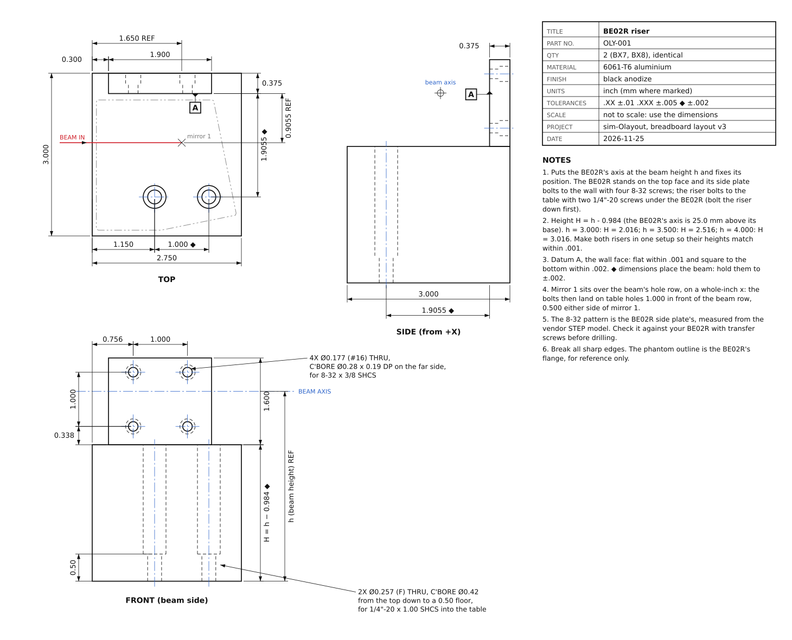
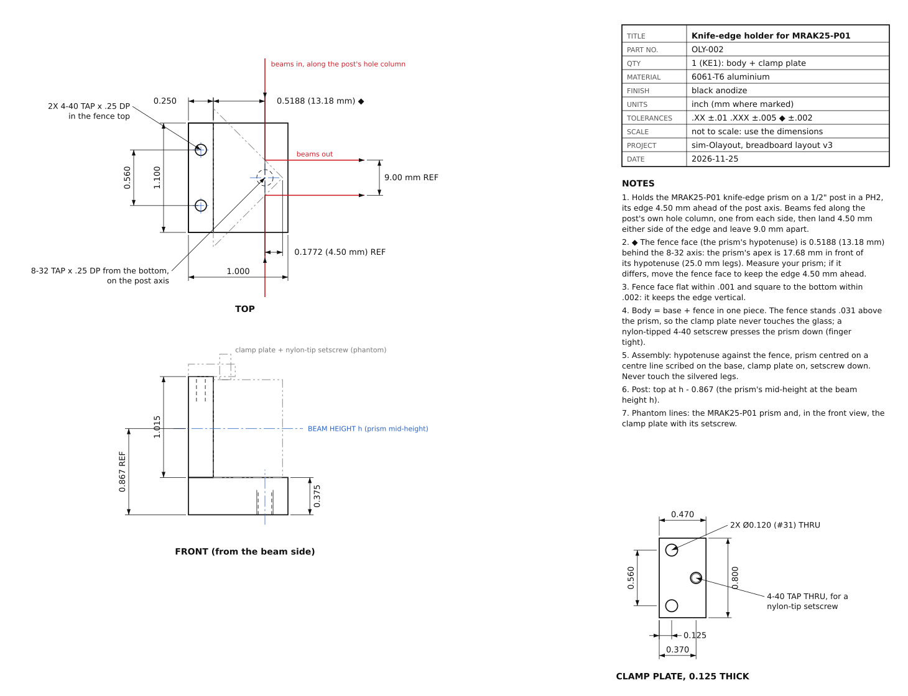
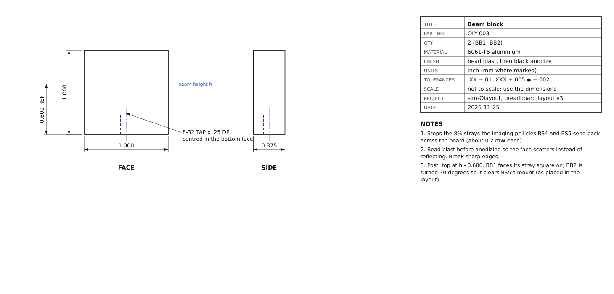
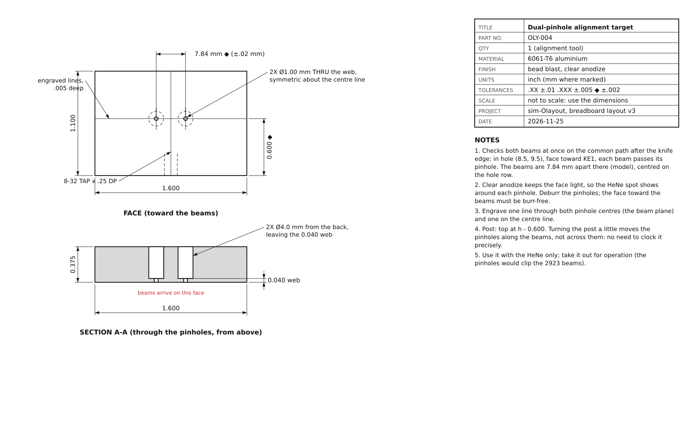

# Custom parts for layout v3

Layout v3 (`breadboard-optimized-v3.olayout.json`, see `v3-layout.md`) uses
four machined parts. Each one replaces a part that had to be placed by eye
with one that lands on the table's holes.

| Part no. | Part | Qty | Used for | Drawing |
|---|---|---|---|---|
| OLY-001 | BE02R riser | 2 | BX7, BX8 | [be02r-riser.svg](drawings/be02r-riser.svg) |
| OLY-002 | Knife-edge holder for MRAK25-P01 (body + clamp plate) | 1 | KE1 | [knife-edge-holder.svg](drawings/knife-edge-holder.svg) |
| OLY-003 | Beam block | 2 | BB1, BB2 | [beam-block.svg](drawings/beam-block.svg) |
| OLY-004 | Dual-pinhole alignment target | 1 | alignment tool, hole (9, 10) | [dual-pinhole-target.svg](drawings/dual-pinhole-target.svg) |

The drawings are generated from the same constants the simulator models the
parts with, so they always match the layout:

```
python -m olayout.tools.drawings            # writes docs/drawings/*.svg
```

All four are 6061-T6 aluminium. Dimensions are in inches unless marked, and
the sheets are not to scale. Tolerances unless noted are ±.01 (.XX) and
±.005 (.XXX). Dimensions marked ◆ place the beam: hold them to ±.002.

## What to settle before machining

- **The beam height `h`.** The riser's height depends on it:
  `H = h − 0.984″`, because the BE02R's axis is 25.0 mm above its base. For
  example, h = 3.500″ gives H = 2.516″. Every other part is set to `h` by
  its post length, so only the riser needs the number.
- **The BE02R's side-plate holes.** The four 8-32 holes come from the vendor
  STEP model: 1.000″ apart in both directions, with the lower pair 0.338″
  above the BE02R's base. Check them on your BE02R with transfer screws
  before drilling the riser's wall.
- **The MRAK25's apex distance.** The holder's fence puts the knife edge
  4.50 mm ahead of the post axis. That assumes the apex is 17.68 mm in front
  of the hypotenuse (25.0 mm legs). Measure your prism. If it differs, move
  the fence face so the edge stays 4.50 mm ahead; the 9.0 mm beam spacing
  depends on it.

## OLY-001 BE02R riser (2×)



An L-shaped block. The BE02R stands on its top face, and the BE02R's side
plate bolts to the wall with four 8-32 × 3/8″ screws. The riser bolts to the
table with two 1/4″-20 × 1.00″ screws, in counterbores that sit under the
BE02R. Bolt the riser down first, then set the BE02R on it.

- **What it fixes.**
  - Height: the riser's top face sets the beam height.
  - Lateral position: the wall face (datum A) sets it. The side plate is
    pulled flat against the wall.
  - Position along the beam: the bolts set it.
- **Where it goes.** With mirror 1 over a hole row at a whole-inch x, the two
  bolts land on the holes 1.000″ in front of the beam row, 0.500″ either side
  of mirror 1. That is holes (10, 15) and (11, 15) for BX7, and (10, 2) and
  (11, 2) for BX8.
- **Making two.** Both risers are identical. Make them in one setup so their
  heights match within .001″.
- **Seating.** The bolt holes are close-fit (Ø0.257″). That holds the riser's
  yaw to a few mrad, and the arm's first steering mirror (M31 or M28) takes up
  the rest.
- **Inside corner.** An end-mill radius of up to 0.06″ between the top face
  and the wall is fine. The BE02R's side plate touches the wall 0.24″ above
  the top face.

## OLY-002 Knife-edge holder (1×)



The holder is a one-piece base and fence on a Ø1/2″ post in a PH2. The prism's
hypotenuse rests against the fence, and its edge sits 4.50 mm ahead of the
8-32 post tap.

- **How it combines the beams.** Both beams come along the post's own hole
  column, one from each side. Each lands 4.50 mm from the edge and the two
  leave 9.0 mm apart. At that distance (2w for the 2923 beam) the edge passes
  more than 99.99% of each beam.
- **Clamping.**
  - A clamp plate screws onto the fence top with two 4-40 screws.
  - A nylon-tipped 4-40 setscrew through the plate presses the prism down.
    Finger tight is enough.
  - The fence stands .031″ above the prism, so the plate itself never touches
    the glass.
- **Centring the prism.** Scribe a centre line on the base and centre the
  prism on it by eye. A small sideways error only shifts both beams together,
  which M22 and M23 correct.
- **Keeping the edge vertical.** The fence face must be square to the bottom
  within .002″. A tilted edge sends the two beams up and down in opposite
  directions. Each arm's mirrors can correct that, but it costs alignment
  time.
- **Post height.** The post's top goes at `h − 0.867″`, which puts the prism's
  mid-height at the beam height.

## OLY-003 Beam block (2×)



A 1.000″ × 1.000″ × 3/8″ block on a post. It stops the 8% strays that the
imaging pellicles BS4 and BS5 send back across the board, about 0.2 mW each.
Without the blocks they land on M29's and M6's mounts.

- **Finish.** Bead blast before black anodizing so the face scatters instead
  of reflecting.
- **Thickness.** The block is 3/8″ thick so its bottom face can take the 8-32
  tap. A 1/8″ plate is too thin for it.
- **Placement.** BB1, in hole (15, 9), faces BS4's stray square on. BB2, in
  hole (13, 6), is turned 30° so it clears BS5's KM200BP. At 45° its weak
  reflection would run straight up the KE1 feed column.

## OLY-004 Dual-pinhole target (1×, alignment tool)



A 1.600″ × 1.100″ × 3/8″ plate with two Ø1.00 mm pinholes, 7.84 mm apart, at
the beam height. It goes in hole (9, 10) on the common path between KE1 and
M22, with its face toward KE1. There, the model puts the two beams 3.92 mm
either side of the hole row. With both beams through their pinholes, the pair
is where the design puts it.

- **Making the pinholes.** Drill them through a 0.040″ web at the beam-side
  face, with Ø4 mm counterbores from the back. Deburr them; the beam-side face
  must be burr-free.
- **Finish.** Use clear anodize, not black, so the HeNe spot shows around
  each pinhole. Engrave one line through both pinhole centres (the beam
  plane) and one on the centre line.
- **Turning the post.** It moves the pinholes along the beams, not across
  them, so the target needs no angular indexing.
- **Use.** Use it with the HeNe tracers only, and take it out for operation:
  the pinholes would clip the 2923 beams, whose 1/e² radius is about 2.2 mm
  there.

## Not drawn

- **Hole in the bottom enclosure panel.** Both pick-offs (M9 and M8, when
  seated) send their samples straight down along x = 7.29″ and off the board's
  bottom edge, to the alignment board below. Cut a Ø1/2″ hole (or a 1/2″-wide
  slot) in the bottom panel, centred at x = 7.29″ from the board's left edge,
  at the beam height. The layout draws this as a gap between panels BD1 and
  BD7.
- **LB1 beam dump.** The catalog's `beam-dump` unit models Thorlabs' LB1 with
  estimated outer dimensions. v3 doesn't use it, because the beam blocks fit
  where an LB1 would not.
